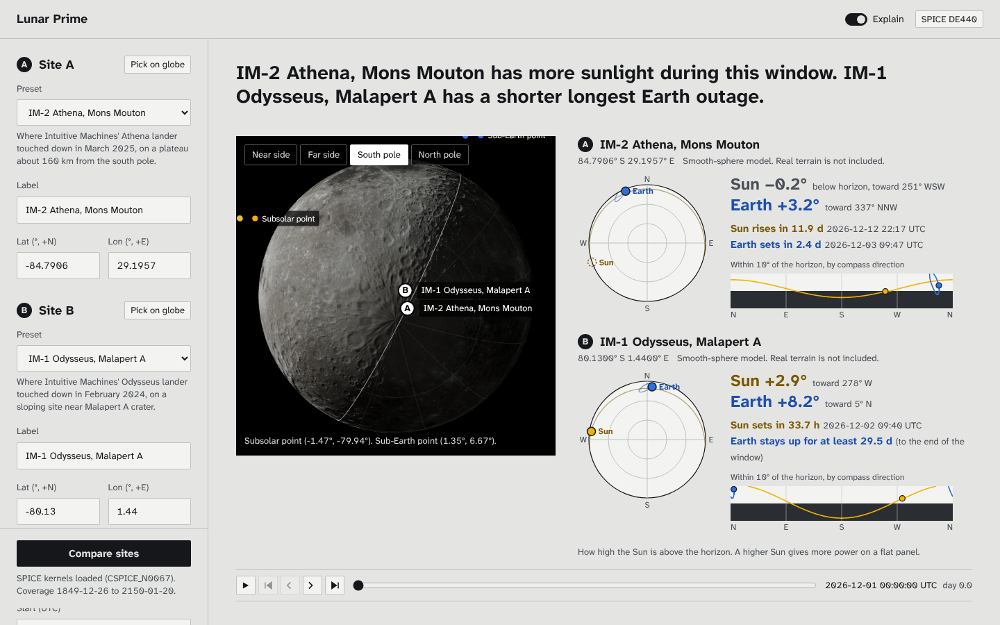

# Lunar Prime

Lunar Prime shows when a place on the Moon has **sunlight** (for power) and **Earth in view** (for direct radio contact). You can compare two landing sites, or the same site on two dates, side by side.

All geometry is computed with NASA/JPL's SPICE toolkit and the DE440 ephemeris. At four south-pole sites, the horizon is the real skyline from NASA's LOLA elevation map.



## Features

- **Pick sites** on a 3D lunar globe, from presets of real missions (IM-1, IM-2, Chandrayaan-3, Blue Ghost 1, Apollo 11 and 17, Chang'e 4 and more), or by typing coordinates.
- **Compare two sites, or one site on two dates.** Site B can start on its own date.
- **Scrub through time.** The globe is lit from the computed Sun position. Each site has a sky plot showing the Sun and Earth, their current elevations, and how long until each one next sets or rises.
- **Real terrain at the south pole.** At the Shackleton rim, the de Gerlache ridge, the Shackleton crater floor and IM-2 (Mons Mouton), the Sun and Earth count as visible only when they clear the real skyline. The sky plots draw that skyline.
- **Answer first.** A short headline, findings and a metrics table: sunlight and Earth-contact time, longest night, longest communication blackout, and time with both visible.
- **Timelines and windows.** Elevation timelines for both sites, and a list of every sunlight and Earth-contact window.
- **Explain mode and tooltips.** A switch adds a plain-language sentence under each number. Hover over any plot, figure or button for a short explanation.
- **Open method.** The Method section lists every convention, the kernels used (with SHA-256), and the limitations. The full result can be exported as JSON.

### Example

Open the app and press **"See it"** under "Why this matters". It puts the Shackleton crater rim beside the crater floor, about 11 km apart. With real terrain, the rim keeps the Sun up for the whole month shown, while the floor gets no sunlight at all over 2027.

## Quick start

You need [uv](https://docs.astral.sh/uv/) (it installs Python 3.12) and Node 20+.

**On a Mac:** double-click `run-lunar-prime.command`. It downloads the SPICE kernels once, downloads a private copy of Node if you don't have one, and starts both servers.

**Step by step:**

```bash
./scripts/fetch_kernels.sh
```

```bash
cd backend && uv sync && uv run uvicorn app.main:app --port 8000
```

```bash
cd frontend && npm install && npm run dev
```

Open http://localhost:3000. The frontend forwards `/api/*` to the backend. Set `BACKEND_URL` if the backend is not at `http://127.0.0.1:8000`.

The terrain skylines are already in `backend/data/horizons/`, so no map download is needed to run the app. To rebuild them, download the LOLA maps (about 390 MB) and run the build script:

```bash
./scripts/fetch_terrain.sh --no-validation
cd backend && uv run python ../scripts/build_horizons.py
```

**Tests:**

```bash
cd backend && uv run pytest
```

```bash
cd frontend && npm run lint && npx tsc --noEmit && npm run build
```

## How it works

For each site and each time step, the backend asks SPICE where the Sun and Earth are as seen from the Moon, then converts that to elevation and azimuth in the site's local sky. A body is "visible" when its centre is above the horizon. When visibility changes between two time steps, the exact crossing time is found by bisection to ±1 second, so durations are real elapsed time, not a count of samples.

At terrain sites, the horizon is not flat. For each of 720 directions around the site, `scripts/build_horizons.py` traces a ray across NASA's LOLA 80 m south-polar elevation map (out to 400 km) and records the highest angle the terrain reaches, as seen from 2 m above the surface. The Sun or Earth is visible only when it is above that skyline in its direction.

| Item | Convention |
|---|---|
| Ephemeris | DE440 (`de440s.bsp`), lunar orientation from `moon_pa_de440_200625.bpc` |
| Frame | `MOON_ME` (Mean-Earth/polar-axis), the LRO/LOLA cartographic frame |
| Coordinates | Planetocentric latitude, east-positive longitude |
| Lunar shape | Sphere, R = 1737.4 km. At terrain sites the observer sits at 1737.4 km + LOLA height + 2 m |
| Aberration | `LT+S` (light time plus stellar aberration) |
| Angles | Elevation = asin(Up/\|r\|); azimuth clockwise from local north |
| Libration | Included, through the DE440 lunar orientation and orbit |
| Time | UTC in and out; TDB internally via `naif0012.tls` |

Gaps that touch the start or end of the window are marked as lower bounds ("≥"), and the comparison text never ranks a gap that is only a lower bound.

## Validation

- **Against SPICE's own routine.** Elevations match SPICE's `azlcpo` to within 2.7 × 10⁻⁵° over 5 sites, 2 bodies and 720 hourly times.
- **Physical checks.** Earth stays up at Apollo 11 and never rises at Chang'e 4 (far side). Apollo 11 gets about 50% sunlight over a lunar day. The sub-Earth point stays within libration limits.
- **Sampling.** Sunrise at 2-hour steps agrees with 5-minute steps to within 3 seconds.
- **Terrain.** The LOLA map gives 2,592 m at IM-1's landing point, against 2,579 m in NASA's LRO release. The Shackleton crater floor gets 0.00% sunlight over 2027, as a permanently shadowed floor should. A flat skyline reproduces the smooth-sphere result exactly.

The backend test suite covers all of the above (`cd backend && uv run pytest`).

## Project layout

```
run-lunar-prime.command     one-click launcher (macOS)
scripts/
  fetch_kernels.sh          download SPICE kernels from NAIF
  fetch_terrain.sh          download LOLA elevation maps (resumable)
  build_horizons.py         compute terrain skylines for the south-pole presets
  validate_terrain.py       terrain checks
backend/
  data/horizons/            precomputed skylines (720 directions each)
  app/
    main.py                 FastAPI: GET /api/health, POST /api/compare
    service.py              runs a comparison; applies terrain skylines
    geometry.py             site vectors, local sky (az/el)
    analysis.py             visibility intervals, refinement, gaps
    terrain.py              LOLA map reading and skyline computation
    narrative.py            headline and findings text (fixed templates)
    models.py               request and response types
    config.py               conventions, limits, kernel list
    kernels.py              kernel loading and checksums
frontend/src/
  components/               app, globe, sky plots, timelines, controls, results, scrubber
  lib/                      API client, presets, explanations, formatting
```

## API

`POST /api/compare`

```json
{
  "sites": [
    {"id": "A", "label": "Apollo 11", "lat_deg": 0.6741, "lon_deg": 23.473},
    {"id": "B", "label": "Shackleton", "lat_deg": -89.67, "lon_deg": 129.78,
     "start_utc": "2026-12-15T00:00:00Z"}
  ],
  "start_utc": "2026-12-01T00:00:00Z",
  "duration_hours": 708.7,
  "step_minutes": 30,
  "mode": "spice"
}
```

`sites[].start_utc` is optional; leave it out and the site uses the main `start_utc`. The response has, per site, Sun and Earth elevation and azimuth over time, visibility intervals and metrics, plus a headline, findings, and metadata (conventions, kernels with SHA-256, limitations). The full schema is at http://localhost:8000/docs.

Limits: duration 1 hour to 366 days, step 1 minute to 24 hours, at most 20,000 samples, dates within kernel coverage (about 1850 to 2150).

There is also a `"mode": "synthetic"` for UI development. It uses a simple analytic model, is clearly labelled as not SPICE data everywhere it appears, and is only used when you select it.

## Kernels

`scripts/fetch_kernels.sh` downloads these from `https://naif.jpl.nasa.gov/pub/naif/generic_kernels/` into `backend/kernels/` (about 45 MB).

| File | Purpose |
|---|---|
| `naif0012.tls` | Leap seconds |
| `pck00011.tpc` | IAU constants, lunar radius |
| `moon_pa_de440_200625.bpc` | Lunar orientation |
| `moon_de440_250416.tf` | Lunar frame definitions |
| `de440s.bsp` | Sun, Earth and Moon positions |

## Limitations

- Terrain is used at the four south-pole presets. Other sites use a smooth sphere, which is accurate away from the poles.
- Visibility is judged by the centre of the Sun or Earth, not the edge of its disc.
- Sunlight is not electrical power (no panels, dust or temperature), and Earth in view is not a guaranteed radio link (no antennas or ground stations).
- When comparing two dates, both share the same duration and time step.

## Credits

- Ephemerides and orientation: NASA/JPL NAIF generic kernels.
- Terrain: NASA GSFC PGDA product 90, "A New View of the Lunar South Pole from LOLA" (Barker et al. 2023, *Planet. Sci. J.* 4, 183).
- Globe imagery: NASA Scientific Visualization Studio *CGI Moon Kit* (LRO LROC WAC mosaic and LOLA elevation, public domain).
